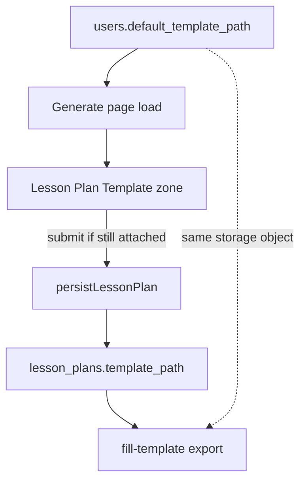

# Default lesson plan template

Date: 2026-11-05
Status: Approved by user, pending spec review

## Goal

Let a teacher save one account-wide default lesson plan template. Opening Generate attaches that file under Lesson Plan Template automatically. They can skip it for one generation, stop using it as the default, or replace it. Settings can view, upload, replace, and remove it.

Today a template is uploaded per visit, stored only on that lesson (`lesson_plans.template_path`), and Generate always starts empty. This feature adds a user-level default. It does not change AI generation: the file is still used later to fill-export, not as prompt context.

## Decisions

- One account-wide default (same pattern as default subject/grade/curriculum). Not per subject.
- Set and remove on Generate and in Settings.
- Generate X = skip this lesson only. Default stays. Next visit auto-attaches again.
- Generate "Stop using as default" and Settings remove both clear the user default. Past lessons keep their `template_path`.
- Uploading a different file on Generate asks a two-choice card, not a yes/no confirm: this lesson only, or this lesson and every new one.
- Settings upload replaces the default immediately (the Settings zone is the default manager).
- Shared storage object. New lessons copy the path onto `lesson_plans.template_path`. Do not copy bytes per lesson.
- Unset and replace never rewrite old lessons and never delete storage while any lesson or the user default still points at the file. Prefer leaving orphans over deleting a file another lesson still fills.
- Lesson page attach/fill dialog is unchanged.
- Curriculum document upload is unchanged. No default curriculum file.

## Copy (English source)

Use these strings. Translate all five locales (en, fr, es, ar, zh-Hans). No em-dashes or en-dashes. ASCII apostrophes.

| Key purpose | Copy |
| --- | --- |
| Opt in (fresh upload, not default) | Use as my default |
| Status when attached as default | Attached for every new lesson. |
| Scan label on the file card | Default |
| Unset default | Stop using as default |
| After unset | Default removed. |
| Undo unset | Undo |
| Failed save | Could not save your default. Try again. |
| Choice title | Use this as your default template? |
| Choice: this generation | This lesson only |
| Choice: replace default | This lesson and every new one |
| Settings heading | Default lesson plan template |
| Settings empty helper | Automatically attached when you generate. |
| Missing object | That file is gone. Upload it again to keep using a default. |
| Settings saved | Saved as default. |

"Remove {name}" on the file-card X stays as today. On Generate it detaches from the form only.

## Data model

Add nullable columns on `public.users`:

- `default_template_path text`
- `default_template_file_name text`

Constraint: both null, or both non-empty. Path must not contain `..`, `\`, or a leading `/`.

New migration `014_users_default_template.sql` (after `013_lock_users_insert_columns.sql`):

1. `ALTER TABLE` the two columns.
2. `GRANT UPDATE (default_template_path, default_template_file_name) ON TABLE public.users TO authenticated;` (additive; do not edit `011`).
3. Do not add them to INSERT grants. They default to null.
4. BEFORE UPDATE trigger: if `default_template_path` is not null, it must pass the same rules as `isOwnedStoragePath(user id, path)` and start with `{id}/template/`. Reject otherwise.
5. Update `lib/supabase/schema.sql` and `types/database.ts` / `types` `User` to match.

The default file is a normal `uploads` row (`type: 'template'`, `lesson_id` null). Storage path stays `{userId}/template/{slug}-{timestamp}.{ext}`.

## Architecture

Writes to the two user columns happen immediately (Generate opt-in / unset / choice, Settings upload / remove). They are not batched with the Settings Save button for subject/grade/curriculum.

## Generate

### Load

[`app/(app)/generate/page.tsx`](app/(app)/generate/page.tsx) already selects `default_subject`, `default_grade`, `default_curriculum`. Also select the two new columns and pass them into `GenerateClient` / `GenerateForm`.

If `default_template_path` is set, the Generate server page checks that the object exists in the `uploads` bucket (metadata or list for that key, not a full download). If it is missing, that same request nulls both user columns, then renders an empty zone and the missing-file message.

If it exists, hydrate the template `DocumentUploadZone` as already attached: original `default_template_file_name`, ready state, no upload/parse, no enter animation on first paint (`initial={false}` / skip motion). Omit file size if unknown. Do not also show "Uploaded. Ready to generate." Default status is the only status line.

`GenerateFormData.templatePath` starts as that path.

### Fresh upload (no default, or default was skipped)

Keep today's upload flow. Under the file card, one text action: **Use as my default**.

That action writes the two user columns immediately, then switches the card to the default state below. On write failure, keep the file attached, show "Could not save your default. Try again.", and leave the opt-in action visible.

### Attached as default

File card plus:

- Scan label: **Default**
- Status: **Attached for every new lesson.**
- Text action: **Stop using as default**
- Existing 44px X: skip this lesson only. Do not call storage remove or delete the `uploads` row.

Stop using as default:

1. Null both user columns immediately.
2. Keep the file on this form (`templatePath` still set) so this generation can still use it.
3. Announce **Default removed.** with **Undo**.
4. Undo restores the previous path and file name. If they generate after unset without Undo, persist links this upload to the new lesson as a normal per-lesson template.

X after a default was attached:

- Clear `templatePath` for this submit only.
- Do not change user columns.
- Do not delete storage.
- Next visit auto-attaches again.

### Uploading a different file while a default exists

After the new file is ready, open a choice dialog using the same Radix Dialog + FreePeriod tokens + reduced-motion pattern as [`FilledTemplateChoiceDialog`](features/lesson/components/FilledTemplateChoiceDialog.tsx). Do not reuse that dialog; add a small Generate-only dialog so export copy stays separate.

- Title: **Use this as your default template?**
- **This lesson only**: keep the old default on the user row. This file is only `templatePath` for this submit. X may delete this new object (today's cleanup) because it is not the default.
- **This lesson and every new one**: write the new path and file name to the user row. Old default path remains on old lessons. Do not delete the old object.

Dismissing the dialog equals **This lesson only**.

### Persist

[`linkUploadsToLesson`](lib/generation/persist.ts) currently updates `uploads.lesson_id` for the template path and fails generate if that update misses.

New rule: if `templatePath === users.default_template_path` for that user, skip linking the template `uploads` row. Leave `lesson_id` null so a later generation cannot steal the default row. Still set `lesson_plans.template_path`. Treat skip as success.

If the path is not the current default, keep today's link behavior.

Fill-export already downloads via `lesson_plans.template_path`. Shared objects work without the `uploads` FK.

## Settings

Place a template `DocumentUploadZone` in the teaching-defaults block of [`SettingsClient`](app/(app)/settings/SettingsClient.tsx), after default curriculum, before country if present.

- Heading: **Default lesson plan template**
- Empty: same accept list as Generate (`.pdf,.docx,.xlsx,.xls`). Helper: **Automatically attached when you generate.**
- Hydrated: same default card as Generate (label + status). Pass `showRemoveButton={false}`. The only remove control is the labeled **Stop using as default** button, so X never means two different things.
- Upload while empty: write columns immediately. Status **Saved as default.**
- Upload while a default exists: replace immediately (no choice dialog). Write columns. Do not delete the previous object.
- Stop using as default: null columns, empty zone, **Default removed.** + **Undo**. Do not delete storage.

Settings already loads `select('*')`. Existence check and stale-column clear happen in the Settings server page before render. Do not require the existing Save button for template writes.

## Component changes

[`DocumentUploadZone`](components/forms/DocumentUploadZone.tsx) and [`useFileUpload`](hooks/useFileUpload.ts) today own file state and **delete storage + the uploads row on X**. That is unsafe for a shared default.

Add:

- Optional `initialAttachment?: { name: string; storagePath: string }` for hydrate-without-upload.
- Optional `cleanupStorageOnRemove?: boolean` (default `true` to preserve today's curriculum and one-off template behavior).
- Optional `showRemoveButton?: boolean` (default `true`). Settings passes `false` so remove is only the labeled Stop using as default action.
- When `cleanupStorageOnRemove` is false, X / remove only resets local state and calls `onRemove`.

Generate passes `cleanupStorageOnRemove={false}` while the attached path equals the current default (including a file just opted-in or chosen as "every new one"). Settings hydrate also uses false; Settings has no X.

New actions (opt in, stop, dialog buttons) use existing `Button` (already `active:scale-[0.96]`, 44px touch height on default size). Status lines use `role="status"`. Prefer `transition-[...]` of specific properties only. Honor `prefers-reduced-motion` and zen mode the same way other dialogs do.

Hit areas for new text actions: at least 44px on touch, 40px desktop. Do not overlap the 44px X.

RTL: logical spacing; Arabic strings in `ar.ts`.

## Errors and security

- Path writes must be owned (`{userId}/template/...`). Client uses `isOwnedStoragePath`. Database trigger is the backstop. Tests cover traversal and another user's prefix.
- Failed column write: revert the control, keep the file, show **Could not save your default. Try again.**
- Missing storage object on load: clear stale columns and explain. Do not leave a ghost filename.
- Account deletion: [`collectStoragePaths`](lib/account/delete-user.ts) must include `users.default_template_path`.
- Authenticated clients still cannot UPDATE `lesson_plans.template_path` (migration 012 unchanged).

## Testing

New or updated:

- Generate: hydrates filename and path; no upload request; no enter animation required in the unit test, but ready state is shown.
- Generate X on a default: `templatePath` null, user columns unchanged, storage remove not called.
- Use as my default / Stop using as default: user update payload, status + Undo restore.
- Different-file choice: both actions; dismiss = this lesson only.
- Settings: upload, replace, remove, missing-file recovery; Save button still only subject/grade/curriculum/country.
- `014` migration: UPDATE grant includes the two columns; privileged columns still excluded. Path trigger rejects foreign prefixes.
- `linkUploadsToLesson` skips when path equals default; still links a non-default template; still fails if a non-default link misses.
- Account deletion collects the default path.
- i18n: new keys present in all five locales; messages test updated.
- e2e: with a seeded default, `/generate` shows the filename under Lesson Plan Template without picking a file.

## Skills to apply on implementation

- **test-driven-development**: failing tests first for hydrate, X-does-not-delete, choice dialog, Settings manage, grants/trigger, persist skip-link, deletion path.
- **better-ui**: concentric radii only where nested padding is under 24px; skip enter animation on hydrated default; Button scale 0.96; 44px hits; no `transition: all`.
- **ux-heuristics**: labeled actions not a checkbox; X meaning consistent; choice card not confirmshaming; undo after unset; visible status; plain-language errors.

## Out of scope

- Per-subject or multiple saved templates.
- Default curriculum document.
- Lesson page "make this my default".
- Using template text in the generation prompt.
- Deleting unused storage objects (orphans stay, same as today).
- Copying a new storage object per lesson.
- Help page copy.

## UX addendum

These UX details were approved by Tashiv on 2026-11-05. They refine presentation and interaction only; they do not change any other decision in this spec.

- **Default chip:** coral text, 11px, 600 weight, uppercase, 0.06em tracking, no tint and no extra padding. Reuse the existing small-chip radius, 8px. Keep the hydrated file card's current 12px radius.
- **Skip + restore:** After X skips the default for this lesson, keep the upload drop zone usable. Below it show "Skipped for this lesson." and a "Use default" action that restores the hydrated default without another upload.
- **Replacement choice dialog:** "This lesson only" receives initial focus. Escape, overlay dismissal and the dialog X all keep the existing default and use the uploaded file for this lesson only. Stack the buttons full width on mobile.
- **Saving / duplicate-write protection:** Disable the active immediate-write action while saving and prevent duplicate writes from double taps. Show "Saving default…" or "Removing default…" using the single ellipsis character. Apply the same duplicate-write protection to Undo and the dialog replacement action.
- **Locales + RTL:** Add the new skip, restore and pending strings to all five locales, with RTL-safe layout.
