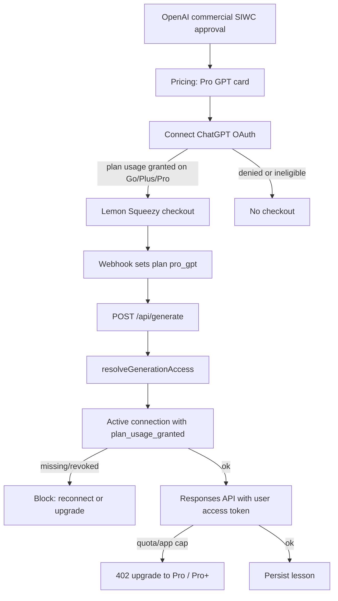

# Pro GPT plan (ChatGPT-connected subscription)

Date: 2026-11-07
Status: Approved in design review, pending spec review

## Goal

Add a fourth paid plan, **Pro GPT**, so a teacher can subscribe to FreePeriod at a lower price and generate lesson plans with their ChatGPT Go, Plus, or Pro quota. FreePeriod still bills through Lemon Squeezy. Gemini and Claude stay the hosted-AI path for Free, Pro, and Pro+.

## Launch blocker (do this first)

Do not start product implementation until OpenAI has approved FreePeriod as a **hosted paid** Sign in with ChatGPT partner and we have credentials that can request ChatGPT plan usage (`chatgpt.tokens.use.direct`) for the Responses API.

Submit the commercial interest form, wait for approval, then store the issued client credentials. The implementation plan’s first task is this application. Pricing, Connect, checkout, and generate for Pro GPT stay unbuilt until that lands.

There is no waitlist, no “coming soon” card, and no public mention of Pro GPT before Connect actually works.

Follow the commercial SIWC + Responses API contract OpenAI issues at approval. Expected shape (from current SIWC docs): OAuth authorization code with PKCE, refresh tokens, bearer access token on `https://api.openai.com/v1`, scope `chatgpt.tokens.use.direct`. If the partner contract differs, the contract wins; this spec’s product rules do not.

## Decisions

| Topic | Choice |
| --- | --- |
| Product name | **Pro GPT** (teacher-facing). Internal plan id `pro_gpt`. |
| Billing | New Lemon Squeezy product. $5/mo or $4/mo billed annually ($48/yr). 30-day trial, same as Pro / Pro+. |
| Who pays for tokens | The teacher’s ChatGPT plan (Go / Plus / Pro). FreePeriod does not call Gemini or Claude for this plan. |
| Entitlements | Unlimited on our side (capped only by ChatGPT quota / per-app weekly cap). Core Free features plus OCR text extraction. No Fast/Quality. No priority support. |
| Connect vs checkout | Connect an eligible ChatGPT plan with plan-usage granted **before** Lemon Squeezy checkout. |
| Quota empty | Hard stop. Primary CTA: upgrade to Pro or Pro+ (we host the AI). Secondary: wait for ChatGPT reset. No FreePeriod-hosted fallback. |
| Auth | Unchanged. Google / email remain FreePeriod login. ChatGPT is a linked connection, not the account. |
| Admin | `users.is_admin` still grants effective Pro+. Admins are not Pro GPT unless they subscribe. |

## Architecture

One Next.js app. Lemon Squeezy still bills. A `chatgpt_connections` row holds OAuth tokens. Generate for `pro_gpt` uses the teacher’s access token against the Responses API.

Split “paid” helpers. Do not reuse today’s `isPaidPlan` (`pro` / `pro_plus`) for Quality unlock:

- **Billed paid:** `pro` / `pro_plus` / `pro_gpt` (trial, webhook, checkout, settings plan label).
- **Hosted Quality:** `pro` / `pro_plus` only. Pro GPT hides Fast/Quality and the server ignores `generationMode`.
- **OCR:** marketing lists OCR text extraction, same as Pro. Do not add a new OCR plan gate. If a gate already exists, include `pro_gpt`.

## Data model

`Plan` becomes `'free' | 'pro' | 'pro_plus' | 'pro_gpt'` in `types/database.ts`, `users.plan`, and `subscriptions.plan`. Extend `subscriptions_plan_check` (and any `users` plan check) to include `pro_gpt`. Update `lib/supabase/schema.sql`.

`PLAN_GENERATION_LIMITS.pro_gpt` is `null`. `resolveEffectivePlan` treats `pro_gpt` like other billed plans (`active`, `on_trial`, trial, cancelled-but-not-ended).

### `chatgpt_connections`

One row per FreePeriod user. Migration `015_chatgpt_connections.sql` (after `014_users_default_template.sql`).

| Column | Rule |
| --- | --- |
| `user_id` | PK, FK `users(id)` ON DELETE CASCADE |
| `openai_account_id` | Stable subject from the OpenAI ID token. Nullable when disconnected |
| `access_token_ciphertext` | Encrypted. Service role only |
| `refresh_token_ciphertext` | Encrypted. Service role only |
| `scopes` | Granted scope string |
| `plan_usage_granted` | true only when granted scopes include `chatgpt.tokens.use.direct` |
| `status` | `active` / `revoked` / `ineligible` |
| `connected_at`, `updated_at` | timestamptz |

Partial unique index: one active link per ChatGPT account (`openai_account_id` unique where `status = 'active'` and the id is not null). Disconnect must not keep the account claimed.

Encrypt tokens with AES-GCM and `CHATGPT_TOKEN_ENCRYPTION_KEY` (32-byte key in env). Never return ciphertext or plaintext to the browser. Authenticated SELECT may expose `status`, `plan_usage_granted`, `openai_account_id`, and timestamps only. Only the service role INSERT/UPDATE/DELETE token columns.

Disconnect: set `status = revoked`, null `openai_account_id` and both ciphertexts, keep the row. Does **not** cancel Lemon Squeezy. Reconnect is a new OAuth on the same row. After disconnect, another FreePeriod user may link that ChatGPT account.

Account deletion: delete the connection row (CASCADE) after wiping tokens in `lib/account/delete-user.ts`. Existing LS cancel stays.

### Lemon Squeezy

Create product **Pro GPT** with a 30-day trial:

- Monthly $5 → `LEMONSQUEEZY_VARIANT_ID_PRO_GPT_MONTHLY`
- Annual $48 ($4/mo) → `LEMONSQUEEZY_VARIANT_ID_PRO_GPT_YEARLY`

Add both to `.env.local.example` plus:

- `OPENAI_SIWC_CLIENT_ID`
- `OPENAI_SIWC_CLIENT_SECRET` (if the commercial contract issues one; omit for PKCE-only)
- `OPENAI_SIWC_REDIRECT_URI`
- `CHATGPT_TOKEN_ENCRYPTION_KEY`

Extend `getVariantIdForPlan`, `getPlanFromVariantId`, and `getBillingIntervalFromVariantId`. Unknown variants still map to `free`. The existing webhook already writes `subscriptions.plan` and `users.plan` via `resolveEffectivePlan`; `pro_gpt` must flow through that.

`PaidPlan` / checkout `PAID_PLANS` include `pro_gpt`.

## Connect and checkout

OAuth start: `GET /api/auth/chatgpt` (session required). Callback: `GET /api/auth/chatgpt/callback`. Request identity scopes plus `offline_access`, `resource.invoke`, and `chatgpt.tokens.use.direct`, resource `https://api.openai.com/v1` (or the partner-doc equivalent). Bind `state` to the signed-in user. PKCE verifier stays server-side.

After the token exchange:

| Granted result | `status` | Checkout |
| --- | --- | --- |
| `chatgpt.tokens.use.direct` present | `active`, `plan_usage_granted = true` | Allowed |
| Signed in but `chatgpt.tokens.use.direct` missing | `ineligible` | Blocked. This is how we treat ChatGPT Free and declined plan-usage. Do not invent a separate plan-tier API unless OpenAI returns one; if they do, require Go, Plus, or Pro as a second check |
| `openai_account_id` already on another user's **active** row | Do not write | Error: that ChatGPT account is already connected |

`POST /api/checkout?plan=pro_gpt` returns **409** with a connect URL unless `status = active` and `plan_usage_granted`. Then create the LS checkout as today (`redirectUrl` `/settings?upgraded=true`).

Signed out on pricing: `/sign-up?plan=pro_gpt` (same pattern as Pro). After session, Connect runs **before** checkout. Do not send them to Lemon Squeezy first.

One active paid plan. Switching Pro GPT ↔ Pro / Pro+ uses the existing customer portal / new checkout behavior. Connecting ChatGPT does not change generation for a Pro / Pro+ subscriber; their provider stays Gemini/Claude.

## Generate

`resolveGenerationAccess` for `pro_gpt`:

1. Effective plan `pro_gpt` as above.
2. Our generation limit is `null` (do not 402 on `generation_count`).
3. Require a live connection (`active` + `plan_usage_granted`). Otherwise block generate with reconnect (primary) and upgrade to Pro / Pro+ (secondary).
4. Refresh the access token if expired. `invalid_grant` / refresh failure → `status = revoked`, same reconnect screen. The teacher never sees token refresh.

`generateLessonContent` third branch: Responses API with the user’s bearer token. Use the model OpenAI lists as eligible for ChatGPT plan usage at implementation time. Do not show that model name in the product UI.

Hide the Fast/Quality control on Generate for `pro_gpt`. If the client still sends `generationMode`, ignore it.

Persist the lesson as today. Still increment `generation_count` for Settings “N generated this period (Unlimited)” copy, but never rate-limit on it.

Settings usage line for `pro_gpt`: existing unlimited wording plus that generations use their ChatGPT plan.

OCR, templates, export, history: same as Pro’s non-model extras except priority support.

## Surfaces and copy

English source below. Translate all five locales. No em-dashes or en-dashes. ASCII apostrophes.

Pricing: fourth card. Order **Free, Pro GPT, Pro, Pro+**. Pro stays featured (“Most Popular”). Do not restyle the page beyond adding the card.

| Key purpose | Copy |
| --- | --- |
| Plan name | Pro GPT |
| Pricing description | Connect your ChatGPT plan. Unlimited lesson plans at a lower FreePeriod price. |
| Feature 1 | Unlimited lesson plans, using your ChatGPT quota |
| Feature 2 | Everything in Free |
| Feature 3 | OCR text extraction |
| Feature 4 | ChatGPT generates every plan (no Fast or Quality modes) |
| Pricing CTA | Connect ChatGPT |
| Checkout blocked | Connect your ChatGPT plan before starting Pro GPT. |
| Ineligible | Pro GPT needs ChatGPT Go, Plus, or Pro, and permission to use that plan here. |
| Already linked | That ChatGPT account is already connected to another FreePeriod user. |
| Reconnect | Reconnect ChatGPT |
| Quota empty | Your ChatGPT quota for FreePeriod is used up. Upgrade to Pro or Pro+ to keep generating with our AI, or wait until ChatGPT resets. |
| Upgrade primary | See Pro and Pro+ |
| Disconnect helper | Disconnecting stops Pro GPT generation. It does not cancel billing. |
| Settings connected | ChatGPT connected |
| Settings usage extra | Uses your ChatGPT plan |

Quota-empty upgrade goes to `/pricing` (hosted Pro / Pro+), not back into Pro GPT. Extend `UpgradePrompt` so the primary action is not hardcoded to a single “Upgrade to Pro” that implies Pro GPT.

Privacy and Terms: add OpenAI as a processor for Pro GPT (identity + inference via Sign in with ChatGPT). Ship in the same release as Connect. Do not claim we read ChatGPT conversations or memories; SIWC plan usage does not grant that.

Help page: show plan name **Pro GPT** when `plan === 'pro_gpt'`.

## Errors

| Situation | Behavior |
| --- | --- |
| Checkout without live connection | 409, Connect CTA |
| Plan-usage scope missing (denied or ChatGPT Free) | `ineligible`, no checkout |
| Disconnect or revoke in ChatGPT | Plan stays `pro_gpt`. Generate blocked. Reconnect primary, upgrade secondary |
| ChatGPT quota or per-app weekly cap | **402**, upgrade copy above. Not the existing “Generation is busy” 429 string |
| Transient OpenAI 429 / 5xx | Existing retry mapping, not an upgrade wall |
| Parse failure from OpenAI output | Same class of retry as Gemini/Claude parse failures |
| Free / Pro / Pro+ request that somehow carries a ChatGPT token | Ignored. Provider follows **their** plan |
| Missing SIWC or encryption env in production | Connect and `pro_gpt` checkout fail closed (500), no partial token writes |

## Testing

- **Unit:** `pro_gpt` in plan resolution, webhook variant mapping, checkout variant ids. Limit is `null`. Checkout 409 without `active` + `plan_usage_granted`. Generate routes to Responses API, never Gemini/Claude. Quota/limit → 402 upgrade copy. Ineligible/revoked blocks generate. Token fields absent from any client serializer. Active `openai_account_id` unique (revoked rows do not block a later link). AES-GCM round-trip; wrong key fails closed. `isPaidPlan` Quality unlock stays false for `pro_gpt`.
- **Component:** Pricing card **Pro GPT** at $5 / $4 annual, 30-day trial language, OCR, no Fast/Quality. Generate hides the mode picker. Settings: connected / reconnect / ineligible. Upgrade prompt for quota empty points at `/pricing`.
- **API / webhook:** LS variant → `pro_gpt`; trial follows existing paid-trial rules. Disconnect does not cancel LS.
- **E2E:** Mock SIWC and the Responses API. CI must not use a real ChatGPT login or live user tokens.
- **i18n:** New keys in en, ar, es, fr, zh-Hans. Messages tests updated. No em-dash / en-dash in new copy.
- **Deletion:** `delete-user` wipes connection tokens.

## Key files

| File | Change |
| --- | --- |
| OpenAI partner application | First implementation-plan task; not code |
| `types/database.ts`, `lib/supabase/schema.sql` | `Plan` + `chatgpt_connections` |
| `supabase/migrations/015_chatgpt_connections.sql` | Table, RLS, grants, unique account id |
| `lib/generation/quota.ts`, `authorize.ts` | `pro_gpt` unlimited + connection check |
| `lib/generation/generate-content.ts` | Responses API branch |
| `lib/generation/map-error.ts` | Quota → 402 vs busy 429 |
| `app/api/generate/route.ts` | Connection and 402 copy |
| `app/api/auth/chatgpt/route.ts` + `callback` | SIWC start and exchange |
| `app/api/checkout/route.ts`, `lib/lemonsqueezy/*` | `pro_gpt` variants; 409 if unconnected |
| `features/billing/components/PricingClient.tsx` | Fourth card, Connect CTA |
| `features/generate/components/GenerateForm.tsx` | Hide Fast/Quality; do not treat as Quality-unlocked |
| `app/(app)/settings/SettingsClient.tsx` | Plan name, connection, usage line |
| `features/billing/components/UpgradePrompt.tsx` | Quota-empty → `/pricing` |
| `lib/account/delete-user.ts` | Wipe connection |
| `lib/i18n/messages/*.ts` | Copy |
| `.env.local.example` | SIWC, encryption key, LS variants |
| Privacy / Terms | OpenAI processor |

## Skills to apply on implementation

- **test-driven-development:** failing tests first for checkout gate, generate routing, 402 vs 429, token secrecy, Quality still locked.
- **writing-plans:** implementation plan starts with OpenAI approval, then LS product, then code.

## Out of scope

- Waitlist or public “coming soon” Pro GPT card
- Sign in with ChatGPT as the FreePeriod **account**
- Bring-your-own OpenAI API keys
- Fast/Quality on Pro GPT
- Spending the teacher’s ChatGPT quota on Pro / Pro+
- A ChatGPT App inside ChatGPT
- Price changes to Pro / Pro+
- Hosted-AI fallback, credits, or top-ups when ChatGPT quota is empty
- Priority support on Pro GPT
- Changing Gemini/Claude models for other plans
