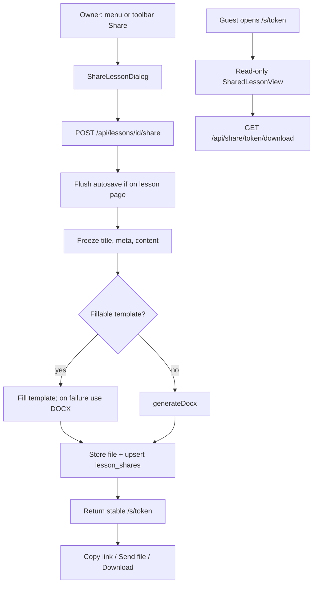

# Share a Frozen Lesson Design

**Status:** Approved (build)
**Branch:** `feat/share_button`
**Date:** 2026-11-16

## Goal

Let a teacher share a lesson from dashboard/history menus and from the lesson-page download toolbar. Recipients open a public read-only page (no account) and can download the frozen document. Sharing again overwrites the same URL with a new freeze. Stop-sharing is out of v1.

## Decisions

| Topic | Choice |
| --- | --- |
| UX pattern | Share sheet (not instant-copy, not OS-share-first): Copy link + Send file + Download file |
| Public URL | Read-only web view of the frozen lesson plus download |
| Freshness | Snapshot at share time; later edits stay private until they share again |
| Reshare | Same token/URL; snapshot and stored file are replaced |
| File output | Filled school template when `isFillableTemplatePath(template_path)`; else Free Period DOCX; fill failure falls back to Free Period DOCX with a note in the sheet |
| Revoke | No revoke UI in v1; deleting the lesson cascades the share row so the link 404s |
| Icon | Lucide Animated Send, adapted in `components/ui/icons/send.tsx` via `createAnimatedIcon` (same pattern as `download.tsx`) |
| UI modes | Operate: Share is quieter than the two download primaries; Read: public share page, not a marketing landing |
| Agents | Orchestrator: Grok 4.6; Implementers: Composer 2.5; Reviewer: Grok 4.6 |

## Architecture

Public reads never query `lesson_plans` (owner-only RLS). Share APIs and the public page use the service-role client. Column grants stay locked: no new client UPDATE on `lesson_plans`.

## Data

New table `lesson_shares` (migration `015_lesson_shares.sql` after `014_users_default_template.sql`; mirror in `lib/supabase/schema.sql`):

| Column | Rule |
| --- | --- |
| `id` | uuid PK, `uuid_generate_v4()` |
| `lesson_id` | uuid, unique FK `lesson_plans(id)` ON DELETE CASCADE |
| `user_id` | uuid FK `users(id)` ON DELETE CASCADE |
| `token` | text unique, unguessable (`crypto.randomBytes(16)` base64url) |
| `snapshot` | jsonb: `title`, `subject`, `grade`, `duration_minutes`, `curriculum`, `content` |
| `file_path` | text, service-role storage path under `uploads` bucket |
| `file_name` | text, attachment filename |
| `content_type` | text, MIME for download |
| `created_at`, `updated_at` | timestamptz |

RLS enabled with **no** `anon` / `authenticated` policies. Grant `ALL` on the table to `service_role` only.

Frozen files live at `shares/{user_id}/{lesson_id}.{ext}` in the private `uploads` bucket. Only the service role uploads and streams them via the download API.

## Surfaces

**Menus** — `LessonMenuItems` in `features/lesson/components/LessonPlanCard.tsx`: Rename, Share, separator, Delete. Covers dashboard (`RecentLessons`) and history (`HistoryClient`) for 3-dot and right-click menus.

**Lesson toolbar** — `features/lesson/components/LessonView.tsx`: keep the two download buttons as the primary pair. Add Share as `soft`/`secondary`, SendIcon + “Share”, full-width under the pair on narrow screens, one row on `sm+`. Flush autosave before POST (same as export).

**ShareLessonDialog** — opens immediately; loading while POST runs. Then:

- Read-only URL field + Copy
- Send file: `navigator.share` with file (+ url/title) when supported
- Download file always (Web Share fallback)
- Quiet note if fill fell back to Free Period DOCX
- i18n keys beside `history.rename` / `history.delete` in all locales

**Public page** — `app/s/[token]/page.tsx`. Not in `lib/auth/protected-paths.ts`. Marketing-light chrome (mark + “Shared lesson”), title/meta, `LESSON_VIEW_SECTIONS` via `SectionValueView` only (no `SectionCard` edit). One Download. `noindex`. No teacher identity. Unknown token: route-level not-found with copy that the shared lesson is unavailable. Quiet “Made with FreePeriod” footer.

## API

| Route | Method | Auth | Behavior |
| --- | --- | --- | --- |
| `/api/lessons/[id]/share` | POST | Owner session | Build snapshot + file, upsert `lesson_shares`, return token and public URL |
| `/api/share/[token]/download` | GET | None | Stream frozen file from storage |

POST response fields: `token`, `url`, `fileName`, `contentType`, `usedDocxFallback`.

## Errors

| Case | Behavior |
| --- | --- |
| 401/403/404 on owner POST | Teacher-friendly error in the dialog |
| Clipboard denied | Keep URL selected; manual-copy message |
| Web Share missing or rejected | Hide or no-op Send; Download remains |
| Invalid token | Public 404 (`app/s/[token]/not-found.tsx`) |
| Delete lesson | CASCADE share row; public 404 |

## Tests (minimum)

- Menu Share item on card (dropdown + context menu)
- POST creates token; second POST same token, new snapshot
- Public page renders snapshot, not live `lesson_plans.content`
- File choice: fillable path vs DOCX; fill failure fallback
- Unauthenticated GET `/s/[token]` 200; owner cannot share another user’s lesson
- Deleted lesson → public 404
- Toolbar Share on lesson view; autosave flush before share

## Out of scope (v1)

Stop sharing / rotate token, email invites, auth-gated shares, live-updating links, generate-form overlay Share, sitemap listing, teacher name on the public page.